# Bundled Plugins

Runline ships with plugins for SaaS, DevOps, productivity, and image-generation APIs, and a `node` plugin for host capabilities. They are part of the `runline` package and need no installation.

A bundled plugin becomes available to `runline exec` once it has a connection. The last column lists each required connection field and, in parentheses, the environment variable that can supply it:

```bash
runline connection add gh --plugin github --set token=$GITHUB_TOKEN
runline exec 'return actions.list("github")'
```

A plugin that uses OAuth shows the `runline auth` command that connects it. See [Connections](connections.md).

<!-- BEGIN PLUGIN TABLE -->
<!-- Generated by: node scripts/generate-plugin-table.js -->
| Plugin | Actions | Resources | Connection fields |
|---|--:|---|---|
|  **actionNetwork** | 23 | attendance, event, person, petition, signature, tag, personTag | `apiKey` (`ACTION_NETWORK_API_KEY`) |
|  **activeCampaign** | 48 | contact, account, accountContact, contactTag, contactList, list, tag, deal, connection, ecomCustomer, ecomOrder, ecomOrderProduct | `apiUrl` (`ACTIVE_CAMPAIGN_API_URL`), `apiKey` (`ACTIVE_CAMPAIGN_API_KEY`) |
| 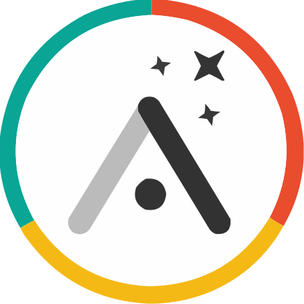 **adalo** | 5 | collection | `appId` (`ADALO_APP_ID`), `apiKey` (`ADALO_API_KEY`) |
|  **affinity** | 16 | list, listEntry, person, organization | `apiKey` (`AFFINITY_API_KEY`) |
|  **agentMail** | 32 | whoami, inbox, message, thread, draft | `apiKey` (`AGENTMAIL_API_KEY`) |
|  **agileCrm** | 15 | contact, company, deal | `subdomain` (`AGILE_CRM_SUBDOMAIN`), `email` (`AGILE_CRM_EMAIL`), `apiKey` (`AGILE_CRM_API_KEY`) |
|  **airtable** | 10 | base, record | `token` (`AIRTABLE_TOKEN`) |
|  **airtop** | 24 | session, window, extraction, interaction, agent, file | `apiKey` (`AIRTOP_API_KEY`) |
|  **apiTemplateIo** | 4 | account, template, image, pdf | `apiKey` (`API_TEMPLATE_IO_API_KEY`) |
|  **asana** | 22 | task, subtask, taskComment, taskTag, taskProject, user, project | `token` (`ASANA_TOKEN`) |
|  **autopilot** | 11 | contact, contactJourney, contactList, list | `apiKey` (`AUTOPILOT_API_KEY`) |
|  **bambooHr** | 11 | employee, employeeDocument, file, companyReport | `subdomain` (`BAMBOO_HR_SUBDOMAIN`), `apiKey` (`BAMBOO_HR_API_KEY`) |
|  **bannerbear** | 4 | image, template | `apiKey` (`BANNERBEAR_API_KEY`) |
| 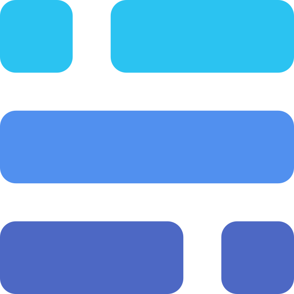 **baserow** | 8 | row | `host` (`BASEROW_HOST`), `token` (`BASEROW_TOKEN`) |
|  **beeminder** | 18 | datapoint, charge, goal, user | `apiToken` (`BEEMINDER_API_TOKEN`) |
|  **bitly** | 3 | link | `accessToken` (`BITLY_ACCESS_TOKEN`) |
|  **bitwarden** | 19 | collection, event, group, member | `clientId` (`BITWARDEN_CLIENT_ID`), `clientSecret` (`BITWARDEN_CLIENT_SECRET`) |
|  **box** | 11 | file, folder | `accessToken` (`BOX_ACCESS_TOKEN`) |
|  **brandfetch** | 5 | brand | `apiKey` (`BRANDFETCH_API_KEY`) |
|  **brevo** | 15 | contact, attribute, email, sender | `apiKey` (`BREVO_API_KEY`) |
|  **bubble** | 5 | object | `apiToken` (`BUBBLE_API_TOKEN`), `appName` (`BUBBLE_APP_NAME`) |
|  **chargebee** | 5 | customer, invoice, subscription | `accountName` (`CHARGEBEE_ACCOUNT_NAME`), `apiKey` (`CHARGEBEE_API_KEY`) |
|  **circleci** | 3 | pipeline | `apiKey` (`CIRCLECI_API_KEY`) |
|  **ciscoWebex** | 10 | message, meeting | `accessToken` (`WEBEX_ACCESS_TOKEN`) |
|  **clearbit** | 3 | person, company | `apiKey` (`CLEARBIT_API_KEY`) |
|  **clickup** | 61 | checklist, checklistItem, comment, folder, goal, goalKeyResult, guest, task, taskTag, taskList, taskDependency, spaceTag, list, timeEntry, timeEntryTag | `accessToken` (`CLICKUP_ACCESS_TOKEN`) |
|  **clockify** | 25 | client, project, tag, task, timeEntry, user, workspace | `apiKey` (`CLOCKIFY_API_KEY`) |
|  **cloudflare** | 4 | zoneCertificate | `apiToken` (`CLOUDFLARE_API_TOKEN`) |
|  **cockpit** | 5 | collection, form, singleton | `url` (`COCKPIT_URL`), `accessToken` (`COCKPIT_ACCESS_TOKEN`) |
|  **coda** | 18 | table, formula, control, view | `accessToken` (`CODA_ACCESS_TOKEN`) |
|  **coingecko** | 10 | coin, event |  |
|  **contentful** | 7 | space, contentType, entry, asset, locale | `spaceId` (`CONTENTFUL_SPACE_ID`), `deliveryAccessToken` (`CONTENTFUL_DELIVERY_TOKEN`) |
| 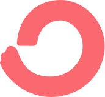 **convertkit** | 16 | customField, form, sequence, tag, tagSubscriber | `apiSecret` (`CONVERTKIT_API_SECRET`) |
|  **copper** | 32 | company, lead, opportunity, person, project, task, customerSource, user | `apiKey` (`COPPER_API_KEY`), `email` (`COPPER_EMAIL`) |
|  **cortex** | 4 | analyzer, job, responder | `host` (`CORTEX_HOST`), `apiKey` (`CORTEX_API_KEY`) |
|  **currents** | 22 | action, instance, project, run, signature, specFile, test, testResult | `apiKey` (`CURRENTS_API_KEY`) |
|  **customerIo** | 9 | campaign, customer, event, segment | `siteId` (`CUSTOMERIO_SITE_ID`), `trackingApiKey` (`CUSTOMERIO_TRACKING_API_KEY`), `appApiKey` (`CUSTOMERIO_APP_API_KEY`) |
|  **databricks** | 34 | sql, files, genie, modelServing, catalog, table, volume, function, vectorSearch | `host` (`DATABRICKS_HOST`), `accessToken` (`DATABRICKS_TOKEN`) |
|  **deepl** | 2 | language | `apiKey` (`DEEPL_API_KEY`) |
|  **demio** | 4 | event, report | `apiKey` (`DEMIO_API_KEY`), `apiSecret` (`DEMIO_API_SECRET`) |
|  **dhl** | 1 | shipment | `apiKey` (`DHL_API_KEY`) |
|  **discord** | 13 | channel, member, message | `botToken` (`DISCORD_BOT_TOKEN`), `guildId` (`DISCORD_GUILD_ID`) |
|  **discourse** | 16 | category, group, post, user, userGroup | `host` (`DISCOURSE_HOST`), `apiKey` (`DISCOURSE_API_KEY`) |
|  **disqus** | 4 | forum | `apiKey` (`DISQUS_API_KEY`) |
|  **docker** | 5 | containers, images | — |
|  **drift** | 5 | contact | `accessToken` (`DRIFT_ACCESS_TOKEN`) |
|  **dropbox** | 15 | account, file, folder, search | `runline auth dropbox` |
|  **dropcontact** | 2 | contact | `apiKey` (`DROPCONTACT_API_KEY`) |
|  **egoi** | 4 | contact | `apiKey` (`EGOI_API_KEY`) |
|  **elasticsearch** | 9 | document, index | `baseUrl` (`ELASTICSEARCH_URL`) |
|  **elevenlabs** | 20 | dialogue, audio, history, voices, pronunciationDictionaries, models, speech, transcription, music, sound | `apiKey` (`ELEVENLABS_API_KEY`) |
|  **emelia** | 9 | campaign, contactList | `apiKey` (`EMELIA_API_KEY`) |
|  **erpnext** | 5 | document | `host` (`ERPNEXT_HOST`), `apiKey` (`ERPNEXT_API_KEY`), `apiSecret` (`ERPNEXT_API_SECRET`) |
|  **facebookGraph** | 1 | request | `accessToken` (`FACEBOOK_ACCESS_TOKEN`) |
|  **facebookPages** | 20 | page, setting, role, rating, post, photo, comment | `accessToken` (`FACEBOOK_PAGE_ACCESS_TOKEN`) |
|  **fal** | 8 | image, video, run, queue | `apiKey` (`FAL_KEY`) |
|  **freshdesk** | 10 | ticket, contact | `domain` (`FRESHDESK_DOMAIN`), `apiKey` (`FRESHDESK_API_KEY`) |
|  **freshservice** | 77 | agent, agentGroup, announcement, asset, assetType, change, department, location, problem, product, release, requester, requesterGroup, software, ticket, agentRole | `domain` (`FRESHSERVICE_DOMAIN`), `apiKey` (`FRESHSERVICE_API_KEY`) |
|  **freshworksCrm** | 35 | account, appointment, contact, deal, note, salesActivity, task, search | `domain` (`FRESHWORKS_CRM_DOMAIN`), `apiKey` (`FRESHWORKS_CRM_API_KEY`) |
|  **getresponse** | 5 | contact | `apiKey` (`GETRESPONSE_API_KEY`) |
|  **gett** | 12 | account, place, driver, ride |  |
|  **ghost** | 5 | post | `url` (`GHOST_URL`), `adminApiKey` (`GHOST_ADMIN_API_KEY`) |
|  **github** | 37 | file, issue, release, commit, branch, repository, review, user, organization, workflow | `token` (`GITHUB_TOKEN`) |
|  **gitlab** | 17 | issue, release, repository, user, file | `token` (`GITLAB_TOKEN`) |
|  **gmail** | 32 | message, thread, draft, label, profile, alias | `runline auth gmail` |
|  **gong** | 4 | call, user | `accessKey` (`GONG_ACCESS_KEY`), `accessKeySecret` (`GONG_ACCESS_KEY_SECRET`) |
|  **googleAds** | 24 | customer, search, field, mutate, campaign, campaignBudget, adGroup, ad, keyword | `runline auth googleAds` |
|  **googleAnalytics** | 40 | report, metadata, accountSummary, account, property, dataStream, customDimension, customMetric, keyEvent, googleAdsLink, firebaseLink | `runline auth googleAnalytics` |
|  **googleAppsScript** | 10 | script, project, file, version, deployment, function, process | `runline auth googleAppsScript` |
|  **googleCalendar** | 22 | calendar, event, freeBusy, calendarList, acl, settings | `runline auth googleCalendar` |
|  **googleContacts** | 10 | contact, group | `runline auth googleContacts` |
|  **googleDocs** | 44 | document | `runline auth googleDocs` |
|  **googleDrive** | 47 | file, folder, fileFolder, drive, comment, reply, revision, changes, permission, accessProposal, about | `runline auth googleDrive` |
|  **googleImage** | 2 | image | `apiKey` (`GOOGLE_API_KEY`) |
|  **googleSheets** | 23 | spreadsheet, sheet, chart, namedRange, protectedRange, conditionalFormat, dataValidation | `runline auth googleSheets` |
|  **googleSlides** | 7 | presentation, page | `runline auth googleSlides` |
|  **googleTasks** | 12 | taskList, task | `runline auth googleTasks` |
|  **gotify** | 3 | message | `url` (`GOTIFY_URL`), `appApiToken` (`GOTIFY_APP_TOKEN`), `clientApiToken` (`GOTIFY_CLIENT_TOKEN`) |
|  **gotowebinar** | 20 | webinar, registrant, session, attendee, coorganizer, panelist | `accessToken` (`GOTO_ACCESS_TOKEN`), `organizerKey` (`GOTO_ORGANIZER_KEY`) |
|  **grafana** | 17 | dashboard, team, teamMember, user | `baseUrl` (`GRAFANA_URL`), `apiKey` (`GRAFANA_API_KEY`) |
|  **graphql** | 2 | query, introspect | `endpoint` (`GRAPHQL_ENDPOINT`) |
| 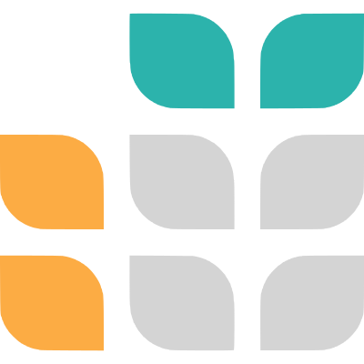 **grist** | 4 | record | `apiKey` (`GRIST_API_KEY`) |
|  **hackernews** | 6 | article, user, all | — |
|  **halopsa** | 20 | client, site, ticket, user | `resourceApiUrl` (`HALOPSA_API_URL`), `clientId` (`HALOPSA_CLIENT_ID`), `clientSecret` (`HALOPSA_CLIENT_SECRET`) |
|  **harvest** | 49 | client, project, task, contact, invoice, expense, estimate, user, timeEntry, company | `token` (`HARVEST_TOKEN`), `accountId` (`HARVEST_ACCOUNT_ID`) |
|  **helpscout** | 13 | conversation, customer, mailbox, thread | `accessToken` (`HELPSCOUT_ACCESS_TOKEN`) |
|  **highlevel** | 17 | contact, opportunity, task, calendar | `accessToken` (`HIGHLEVEL_ACCESS_TOKEN`), `locationId` (`HIGHLEVEL_LOCATION_ID`) |
| 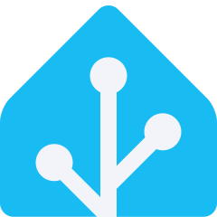 **homeAssistant** | 13 | config, service, state, event, log, template, history | `host` (`HASS_HOST`), `accessToken` (`HASS_TOKEN`) |
|  **hubspot** | 32 | contact, company, deal, ticket, contactList, engagement, form | `accessToken` (`HUBSPOT_ACCESS_TOKEN`) |
|  **humanticAi** | 3 | profile | `apiKey` (`HUMANTIC_AI_API_KEY`) |
|  **hunter** | 3 | domainSearch, emailFinder, emailVerifier | `apiKey` (`HUNTER_API_KEY`) |
|  **instagram** | 37 | account, page, user, media, story, tag, container, comment, mention, hashtag, conversation, message | `accessToken` (`INSTAGRAM_ACCESS_TOKEN`) |
|  **intercom** | 10 | contact, company | `accessToken` (`INTERCOM_ACCESS_TOKEN`) |
|  **iterable** | 6 | event, user, userList | `apiKey` (`ITERABLE_API_KEY`) |
|  **jenkins** | 11 | job, build, instance | `baseUrl` (`JENKINS_URL`), `username` (`JENKINS_USER`), `apiToken` (`JENKINS_TOKEN`) |
|  **jira** | 16 | issue, issueComment, user | `domain` (`JIRA_DOMAIN`), `email` (`JIRA_EMAIL`), `apiToken` (`JIRA_API_TOKEN`) |
|  **keap** | 28 | company, contact, contactNote, contactTag, order, product, email, file | `accessToken` (`KEAP_ACCESS_TOKEN`) |
|  **kobotoolbox** | 17 | form, submission, hook, file | `url` (`KOBOTOOLBOX_URL`), `token` (`KOBOTOOLBOX_TOKEN`) |
|  **lemlist** | 15 | activity, campaign, lead, team, unsubscribe, enrich | `apiKey` (`LEMLIST_API_KEY`) |
|  **linear** | 89 | issue, comment, state, label, project, milestone, projectUpdate, view, cycle, team, initiative, user, attachment, org, webhook | `apiKey` (`LINEAR_API_KEY`) |
|  **lingvanex** | 1 | translate | `apiKey` (`LINGVANEX_API_KEY`) |
|  **linkedin** | 1 | post | `accessToken` (`LINKEDIN_ACCESS_TOKEN`) |
|  **lonescale** | 4 | list, item | `apiKey` (`LONESCALE_API_KEY`) |
|  **magento** | 15 | customer, invoice, order, product | `host` (`MAGENTO_HOST`), `accessToken` (`MAGENTO_ACCESS_TOKEN`) |
|  **mailcheck** | 1 | email | `apiKey` (`MAILCHECK_API_KEY`) |
|  **mailchimp** | 14 | member, memberTag, listGroup, campaign | `apiKey` (`MAILCHIMP_API_KEY`) |
|  **mailerlite** | 4 | subscriber | `apiKey` (`MAILERLITE_API_KEY`) |
|  **mailgun** | 1 | email | `apiKey` (`MAILGUN_API_KEY`), `emailDomain` (`MAILGUN_EMAIL_DOMAIN`) |
|  **mailjet** | 3 | email, sms | `apiKeyPublic` (`MAILJET_API_KEY`), `apiKeyPrivate` (`MAILJET_SECRET_KEY`) |
|  **mandrill** | 2 | message | `apiKey` (`MANDRILL_API_KEY`) |
|  **marketstack** | 3 | endOfDayData, exchange, ticker | `apiKey` (`MARKETSTACK_API_KEY`) |
|  **matrix** | 10 | account, room, message, event, roomMember | `homeserverUrl` (`MATRIX_HOMESERVER_URL`), `accessToken` (`MATRIX_ACCESS_TOKEN`) |
|  **mattermost** | 19 | channel, message, reaction, user | `baseUrl` (`MATTERMOST_URL`), `accessToken` (`MATTERMOST_TOKEN`) |
|  **mautic** | 20 | company, contact, contactSegment, campaignContact, companyContact, segmentEmail | `url` (`MAUTIC_URL`), `username` (`MAUTIC_USERNAME`), `password` (`MAUTIC_PASSWORD`) |
|  **medium** | 3 | post, publication, me | `accessToken` (`MEDIUM_ACCESS_TOKEN`) |
|  **messagebird** | 2 | sms, balance | `accessKey` (`MESSAGEBIRD_ACCESS_KEY`) |
| 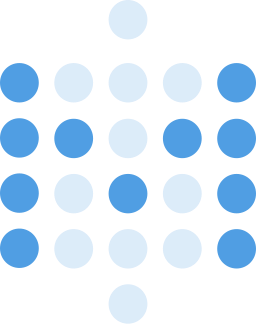 **metabase** | 10 | question, alert, database, metric | `url` (`METABASE_URL`), `sessionToken` (`METABASE_SESSION_TOKEN`) |
|  **microsoftCalendar** | 13 | calendar, event | `runline auth microsoftCalendar` |
|  **microsoftFiles** | 5 | files, folder | `runline auth microsoftFiles` |
|  **microsoftMail** | 11 | mail, draft, attachment | `runline auth microsoftMail` |
|  **misp** | 44 | attribute, event, eventTag, feed, galaxy, noticelist, object, organisation, tag, user, warninglist | `baseUrl` (`MISP_URL`), `apiKey` (`MISP_API_KEY`) |
|  **mocean** | 2 | sms, voice | `apiKey` (`MOCEAN_API_KEY`), `apiSecret` (`MOCEAN_API_SECRET`) |
|  **monday** | 18 | board, boardColumn, boardGroup, boardItem | `apiToken` (`MONDAY_API_TOKEN`) |
|  **monicaCrm** | 45 | contact, activity, note, task, tag, journalEntry, reminder, call, conversation | `apiToken` (`MONICA_API_TOKEN`) |
|  **msg91** | 1 | sms | `authkey` (`MSG91_AUTHKEY`) |
|  **nasa** | 14 | apod, asteroidNeoFeed, asteroidNeoLookup, asteroidNeoBrowse, donki, earthAssets | `apiKey` (`NASA_API_KEY`) |
| 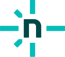 **netlify** | 7 | deploy, site | `accessToken` (`NETLIFY_ACCESS_TOKEN`) |
|  **netscalerAdc** | 3 | certificate, file | `url` (`NETSCALER_URL`), `username` (`NETSCALER_USERNAME`), `password` (`NETSCALER_PASSWORD`) |
|  **nextcloud** | 13 | file, folder, user | `webDavUrl` (`NEXTCLOUD_WEBDAV_URL`), `username` (`NEXTCLOUD_USERNAME`), `password` (`NEXTCLOUD_PASSWORD`) |
|  **nocodb** | 5 | row | `host` (`NOCODB_HOST`), `apiToken` (`NOCODB_API_TOKEN`) |
|  **node** | 38 | fs, path, os, process, crypto, fetch | — |
|  **notion** | 14 | block, database, page, user | `apiKey` (`NOTION_API_KEY`) |
|  **npm** | 5 | package, distTag |  |
|  **odoo** | 6 | record, model | `url` (`ODOO_URL`), `username` (`ODOO_USERNAME`), `password` (`ODOO_PASSWORD`) |
|  **okta** | 5 | user | `url` (`OKTA_URL`), `apiToken` (`OKTA_API_TOKEN`) |
|  **oneSimpleApi** | 10 | website, socialProfile, information, utility | `apiToken` (`ONE_SIMPLE_API_TOKEN`) |
|  **onfleet** | 34 | organization, task, worker, admin, hub, team, recipient, container, destination | `apiKey` (`ONFLEET_API_KEY`) |
|  **openai** | 2 | image | `apiKey` (`OPENAI_API_KEY`) |
|  **openThesaurus** | 1 | synonyms | — |
|  **openweathermap** | 2 | weather | `apiKey` (`OPENWEATHERMAP_API_KEY`) |
|  **oura** | 4 | profile, summary | `accessToken` (`OURA_ACCESS_TOKEN`) |
|  **paddle** | 9 | coupon, payment, plan, product, user | `vendorId` (`PADDLE_VENDOR_ID`), `vendorAuthCode` (`PADDLE_VENDOR_AUTH_CODE`) |
|  **pagerduty** | 9 | incident, incidentNote, logEntry, user | `apiToken` (`PAGERDUTY_API_TOKEN`) |
|  **parallel** | 1 | search | `apiKey` (`PARALLEL_API_KEY`) |
|  **paypal** | 4 | payout, payoutItem | `clientId` (`PAYPAL_CLIENT_ID`), `secret` (`PAYPAL_SECRET`) |
|  **peekalink** | 2 | link | `apiKey` (`PEEKALINK_API_KEY`) |
|  **phantombuster** | 5 | agent | `apiKey` (`PHANTOMBUSTER_API_KEY`) |
|  **philipsHue** | 4 | light | `accessToken` (`PHILIPS_HUE_ACCESS_TOKEN`), `username` (`PHILIPS_HUE_USERNAME`) |
|  **pipedrive** | 47 | activity, deal, dealProduct, file, lead, note, organization, person, product | `apiToken` (`PIPEDRIVE_API_TOKEN`) |
|  **plaud** | 9 | user, recording, transcript, summary, note | `runline auth plaud` |
|  **plivo** | 3 | sms, mms, call | `authId` (`PLIVO_AUTH_ID`), `authToken` (`PLIVO_AUTH_TOKEN`) |
| 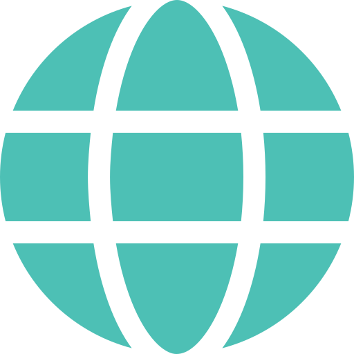 **postbin** | 6 | bin, request | — |
| 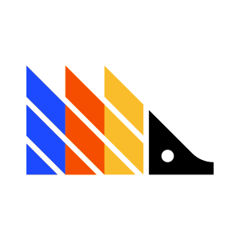 **posthog** | 5 | alias, event, identity, track | `url` (`POSTHOG_URL`), `apiKey` (`POSTHOG_API_KEY`) |
|  **profitwell** | 2 | company, metric | `accessToken` (`PROFITWELL_ACCESS_TOKEN`) |
|  **pushbullet** | 4 | push | `accessToken` (`PUSHBULLET_ACCESS_TOKEN`) |
|  **pushcut** | 1 | notification | `apiKey` (`PUSHCUT_API_KEY`) |
| 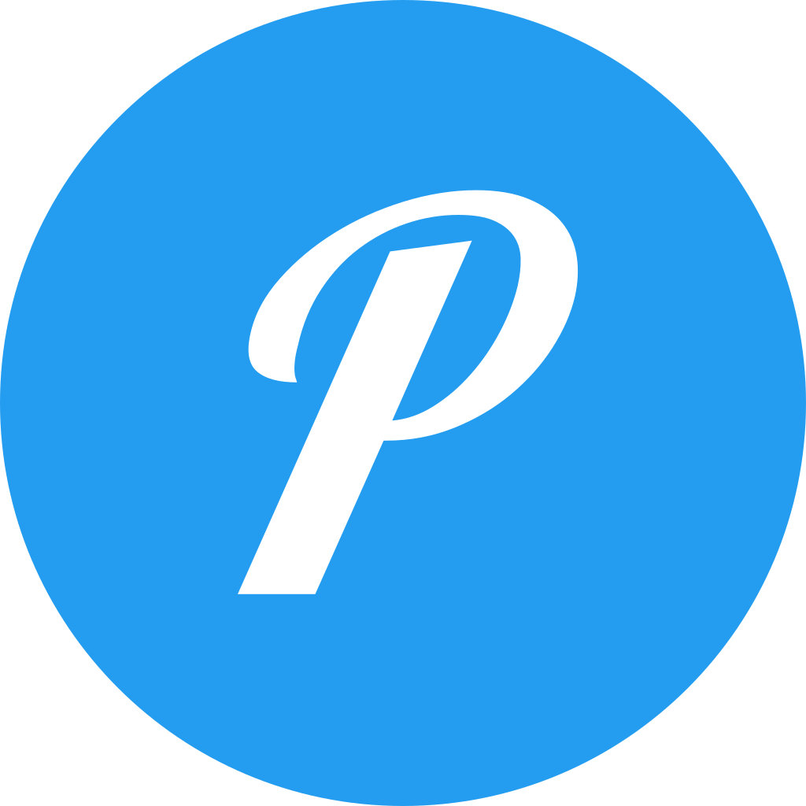 **pushover** | 1 | message | `apiToken` (`PUSHOVER_API_TOKEN`) |
|  **quickbase** | 8 | field, file, record, report | `hostname` (`QUICKBASE_HOSTNAME`), `userToken` (`QUICKBASE_USER_TOKEN`) |
| 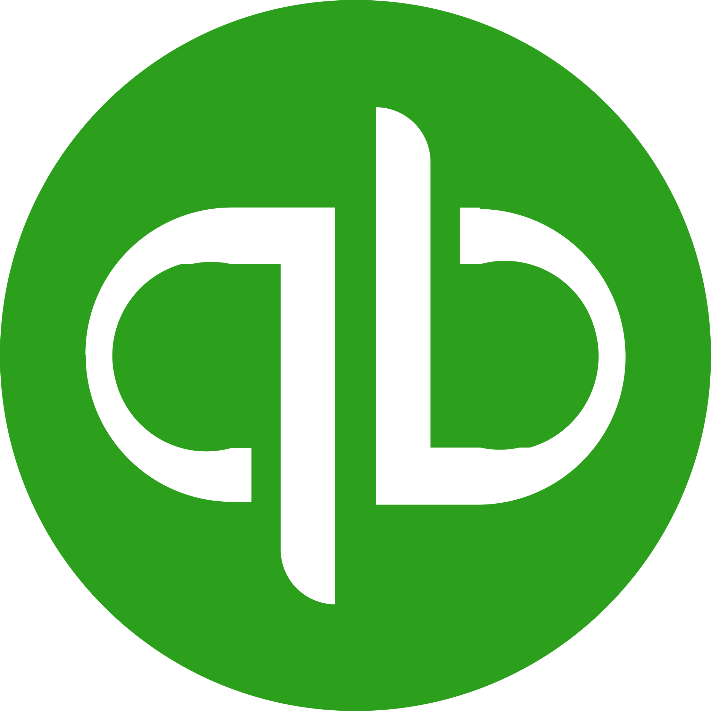 **quickbooks** | 45 | bill, customer, employee, estimate, invoice, item, payment, purchase, vendor | `accessToken` (`QUICKBOOKS_ACCESS_TOKEN`), `companyId` (`QUICKBOOKS_COMPANY_ID`) |
| 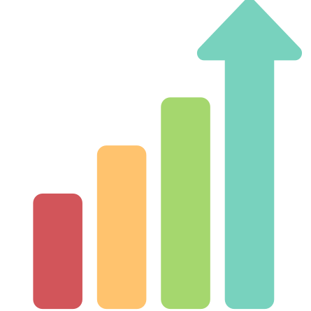 **quickchart** | 1 | chart | — |
|  **raindrop** | 13 | bookmark, collection, tag, user | `accessToken` (`RAINDROP_ACCESS_TOKEN`) |
|  **recraft** | 2 | image | `apiKey` (`RECRAFT_API_KEY`) |
|  **reddit** | 10 | post, comment, subreddit, user |  |
|  **replicate** | 2 | image | `apiToken` (`REPLICATE_API_TOKEN`) |
|  **rocketchat** | 1 | chat | `domain` (`ROCKETCHAT_DOMAIN`), `userId` (`ROCKETCHAT_USER_ID`), `authToken` (`ROCKETCHAT_AUTH_TOKEN`) |
|  **rundeck** | 2 | job | `url` (`RUNDECK_URL`), `token` (`RUNDECK_TOKEN`) |
|  **salesforce** | 63 | connection, auth, limits, metadata, soql, account, contact, lead, opportunity, case, task, user, sobject |  |
|  **salesmate** | 15 | company, activity, deal | `sessionToken` (`SALESMATE_SESSION_TOKEN`), `linkname` (`SALESMATE_LINKNAME`) |
|  **securityScorecard** | 14 | company, industry, portfolio, portfolioCompany, invite, report | `apiKey` (`SECURITYSCORECARD_API_KEY`) |
|  **segment** | 4 | identify, track, group | `writeKey` (`SEGMENT_WRITE_KEY`) |
|  **sendgrid** | 10 | mail, contact, list | `apiKey` (`SENDGRID_API_KEY`) |
|  **sendy** | 6 | campaign, subscriber | `url` (`SENDY_URL`), `apiKey` (`SENDY_API_KEY`) |
|  **sentry** | 21 | event, issue, organization, project, release, team | `token` (`SENTRY_TOKEN`) |
|  **servicenow** | 40 | incident, user, userGroup, userRole, businessService, configurationItem, department, tableRecord | `subdomain` (`SERVICENOW_SUBDOMAIN`), `username` (`SERVICENOW_USERNAME`), `password` (`SERVICENOW_PASSWORD`) |
| 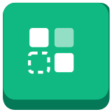 **shiftAtlas** | 35 | summary, graph, stage, actor, line, journey, labels, change, task, assignment, relation, binding, evidence | `apiKey` (`SHIFT_LABS_API_KEY`) |
|  **shiftBwm** | 27 | objectType, definition, pipeline, record, merge, savedList, group, member, file | `apiKey` (`SHIFT_LABS_API_KEY`) |
|  **shiftCrm** | 40 | access, account, person, pipeline, opportunity, activity, task, record, propertyDefinition, import | `apiKey` (`SHIFT_CRM_API_KEY`) |
| 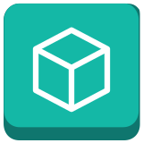 **shiftObjects** | 8 | object | `apiKey` (`SHIFT_LABS_API_KEY`) |
|  **shiftOcr** | 2 | ocr | `apiKey` (`SHIFT_LABS_API_KEY`) |
|  **shiftPages** | 11 | page | `apiKey` (`SHIFT_LABS_API_KEY`) |
|  **shiftTranscription** | 7 | transcription | `apiKey` (`SHIFT_LABS_API_KEY`) |
|  **shiftWork** | 29 | project, issue, issueView | `apiKey` (`SHIFT_LABS_API_KEY`) |
|  **shopify** | 10 | order, product | `shopSubdomain` (`SHOPIFY_SUBDOMAIN`), `accessToken` (`SHOPIFY_ACCESS_TOKEN`) |
|  **signl4** | 2 | alert | `teamSecret` (`SIGNL4_TEAM_SECRET`) |
|  **slack** | 38 | message, channel, reaction, user, userGroup, file, star | `accessToken` (`SLACK_ACCESS_TOKEN`) |
|  **sms77** | 2 | sms, voice | `apiKey` (`SMS77_API_KEY`) |
|  **splunk** | 16 | search, alert, report, user | `baseUrl` (`SPLUNK_BASE_URL`), `authToken` (`SPLUNK_AUTH_TOKEN`) |
|  **spotify** | 30 | player, album, artist, playlist, track, library, myData | `accessToken` (`SPOTIFY_ACCESS_TOKEN`) |
|  **stackby** | 4 | row | `apiKey` (`STACKBY_API_KEY`) |
|  **steel** | 59 | session, scrape, browser, screenshot, pdf, page, file, sessionFile, credential, profile, extension, captcha | `apiKey` (`STEEL_API_KEY`) |
|  **storyblok** | 7 | content, management |  |
|  **strapi** | 5 | entry | `url` (`STRAPI_URL`) |
| 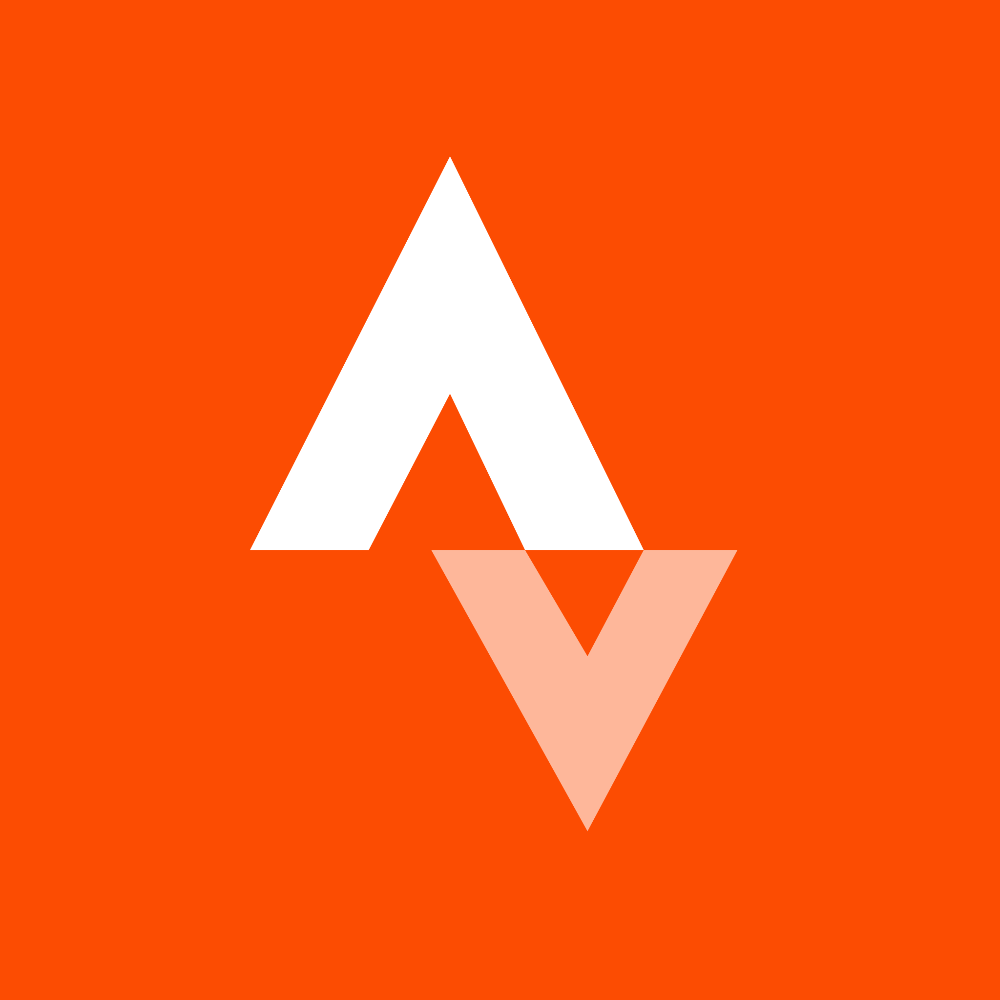 **strava** | 9 | activity | `accessToken` (`STRAVA_ACCESS_TOKEN`) |
| 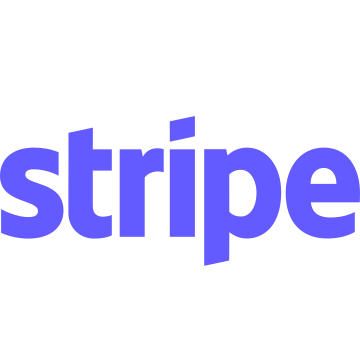 **stripe** | 20 | balance, customer, charge, coupon, customerCard, source, token, meterEvent | `secretKey` (`STRIPE_SECRET_KEY`) |
|  **supabase** | 5 | row | `host` (`SUPABASE_URL`), `serviceRole` (`SUPABASE_SERVICE_ROLE_KEY`) |
|  **syncromsp** | 20 | customer, contact, ticket, rmmAlert | `subdomain` (`SYNCROMSP_SUBDOMAIN`), `apiKey` (`SYNCROMSP_API_KEY`) |
| 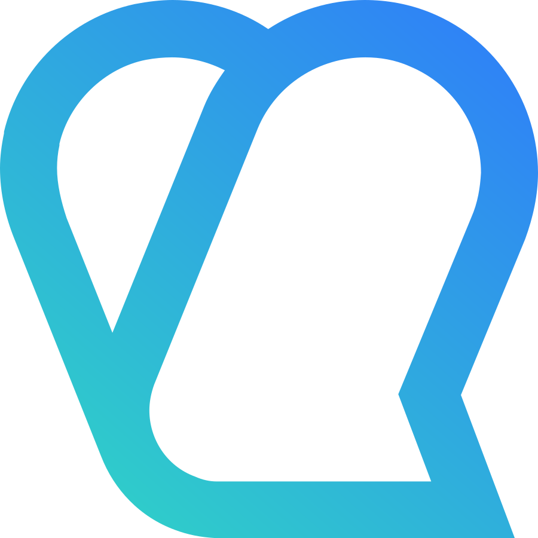 **tapfiliate** | 11 | affiliate, affiliateMetadata, programAffiliate | `apiKey` (`TAPFILIATE_API_KEY`) |
|  **telegram** | 21 | message, chat, callback, file | `accessToken` (`TELEGRAM_BOT_TOKEN`) |
| 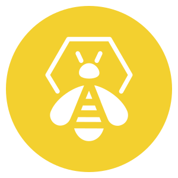 **thehive** | 23 | alert, case, observable, task, log | `url` (`THEHIVE_URL`), `apiKey` (`THEHIVE_API_KEY`) |
| 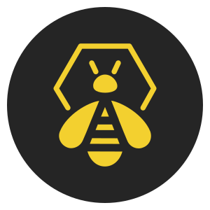 **thehiveProject** | 37 | alert, case, task, observable, comment, log, page, query | `url` (`THEHIVE_URL`), `apiKey` (`THEHIVE_API_KEY`) |
|  **todoist** | 33 | task, project, section, comment, label | `apiToken` (`TODOIST_API_TOKEN`) |
| 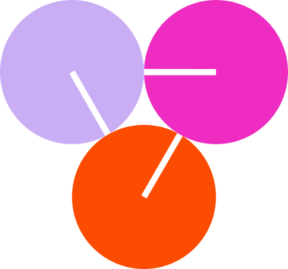 **together** | 2 | image | `apiKey` (`TOGETHER_API_KEY`) |
|  **travisci** | 5 | build | `apiToken` (`TRAVISCI_API_TOKEN`) |
|  **trello** | 37 | board, boardMember, card, cardComment, list, attachment, checklist, label | `apiKey` (`TRELLO_API_KEY`), `token` (`TRELLO_TOKEN`) |
|  **twake** | 1 | message | `apiKey` (`TWAKE_API_KEY`) |
|  **twilio** | 2 | sms, call | `accountSid` (`TWILIO_ACCOUNT_SID`), `authToken` (`TWILIO_AUTH_TOKEN`) |
|  **twist** | 22 | channel, thread, comment, messageConversation | `accessToken` (`TWIST_ACCESS_TOKEN`) |
|  **twitter** | 8 | tweet, user, list, dm | `bearerToken` (`TWITTER_BEARER_TOKEN`) |
| 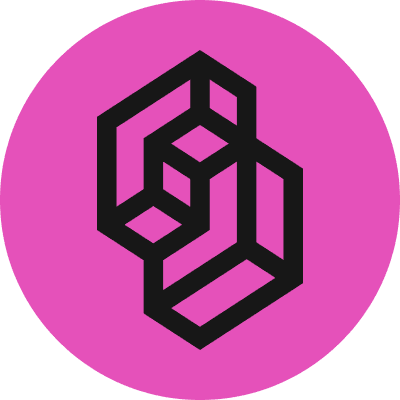 **typesafe** | 7 | evaluate, choice, score, noul, raw, model, guide | `apiKey` (`TYPESAFE_API_KEY`) |
|  **unleashedSoftware** | 3 | salesOrder, stockOnHand | `apiId` (`UNLEASHED_API_ID`), `apiKey` (`UNLEASHED_API_KEY`) |
|  **uplead** | 2 | person, company | `apiKey` (`UPLEAD_API_KEY`) |
|  **uproc** | 1 | process | `email` (`UPROC_EMAIL`), `apiKey` (`UPROC_API_KEY`) |
| 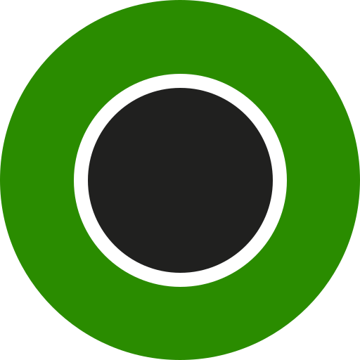 **uptimerobot** | 22 | account, monitor, alertContact, maintenanceWindow, publicStatusPage | `apiKey` (`UPTIMEROBOT_API_KEY`) |
|  **urlscanio** | 3 | scan | `apiKey` (`URLSCANIO_API_KEY`) |
|  **vercel** | 14 | whoami, project, deployment, env | `token` (`VERCEL_TOKEN`) |
| 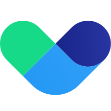 **vero** | 8 | user, event | `authToken` (`VERO_AUTH_TOKEN`) |
|  **vonage** | 1 | sms | `apiKey` (`VONAGE_API_KEY`), `apiSecret` (`VONAGE_API_SECRET`) |
|  **wekan** | 24 | board, list, card, cardComment, checklist, checklistItem | `url` (`WEKAN_URL`), `token` (`WEKAN_TOKEN`) |
|  **wolt** | 20 | venue, menu, item, account, address, order |  |
|  **woocommerce** | 15 | product, order, customer | `url` (`WOOCOMMERCE_URL`), `consumerKey` (`WOOCOMMERCE_CONSUMER_KEY`), `consumerSecret` (`WOOCOMMERCE_CONSUMER_SECRET`) |
|  **wordpress** | 15 | post, page, user | `url` (`WORDPRESS_URL`), `username` (`WORDPRESS_USERNAME`), `password` (`WORDPRESS_PASSWORD`) |
|  **xai** | 2 | image | `apiKey` (`XAI_API_KEY`) |
|  **xero** | 8 | invoice, contact | `accessToken` (`XERO_ACCESS_TOKEN`), `tenantId` (`XERO_TENANT_ID`) |
|  **yourls** | 3 | url | `url` (`YOURLS_URL`), `signature` (`YOURLS_SIGNATURE`) |
|  **zammad** | 22 | user, organization, group, ticket | `url` (`ZAMMAD_URL`), `token` (`ZAMMAD_TOKEN`) |
|  **zendesk** | 18 | ticket, user, organization, ticketField | `subdomain` (`ZENDESK_SUBDOMAIN`), `email` (`ZENDESK_EMAIL`), `apiToken` (`ZENDESK_API_TOKEN`) |
|  **zoho** | 60 | account, contact, deal, invoice, lead, product, purchaseOrder, salesOrder, vendor, quote | `accessToken` (`ZOHO_ACCESS_TOKEN`) |
|  **zohoMail** | 9 | account, folder, label, message | `runline auth zohoMail` |
|  **zoom** | 5 | meeting | `accessToken` (`ZOOM_ACCESS_TOKEN`) |
| 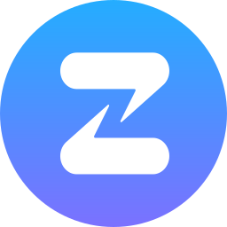 **zulip** | 15 | message, stream, user | `url` (`ZULIP_URL`), `email` (`ZULIP_EMAIL`), `apiKey` (`ZULIP_API_KEY`) |
<!-- END PLUGIN TABLE -->
