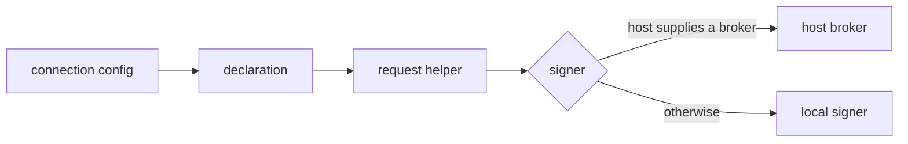

# Credentials

A plugin that calls an authenticated API declares its credential. The declaration states what the secret is, how it is placed in a request, and which HTTPS targets may receive it. Runline signs every request from that declaration, so the plugin never builds an `Authorization` header, reads a token, or refreshes one.

Use this page when you write a plugin, bundled or your own, that needs a key, a token, an OAuth login, AWS credentials, or a cookie session. To embed runline with credentials kept outside the process that runs plugins, see [Sign requests in the host](sdk.md#sign-requests-in-the-host).

## Understand the model

A credentialed request passes through three pieces. The plugin writes the first two:



- A declaration is a function from the connection's config to a selection: the credential type with its methods, each with an authentication kind and targets, which method this connection uses, and any OAuth application, resource owner, or AWS role. It is pure. It performs no IO and never reads action input. `staticCredential` and `awsCredential` build one for you. OAuth and cookie-session declarations are written out.
- A request helper, such as `credentialJson`, `credentialOk`, or `credentialRequest`, takes a target name and a path beneath it, never a URL. Runline refuses anything outside the declared targets, methods, and headers before it sends a byte.
- The signer adds the secret, renews it when it expires or is rejected, and stores the renewal. When a host keeps credentials, the plugin's process never holds the secret. The same plugin code runs either way.

This design has three consequences. The secret can reach only the hosts the plugin declared. A provider's error text, which can echo a secret, never reaches an error message. A host can sign for plugin code it does not trust with its tokens.

## Declare an API key

The [orders plugin](plugins.md#authenticate-requests) in the plugin guide is built around one credential. These are its credential parts:

```typescript
import { credentialJson, pathSegment, staticCredential } from "runline";

// A bearer token from the connection's `apiKey`, sent only beneath this base.
const credential = staticCredential({
  id: "orders",
  auth: { kind: "bearer" },
  local: { secret: "apiKey" },
  targets: {
    api: { baseUrl: "https://api.orders.example/v1/", methods: ["GET"] },
  },
});

// When the plugin registers:
rl.setCredential(credential);
rl.setConnectionSchema(t.Object({ apiKey: t.String({ env: "ORDERS_API_KEY" }) }));

// In an action:
return credentialJson(ctx, credential, "orders", {
  target: "api",
  path: `orgs/${pathSegment(orgId)}/orders`,
});
```

Four things make it work:

1. `setCredential(credential)` tells runline (and a host) how this plugin signs. Without it, the request helpers still sign locally, but a host cannot broker for the plugin.
2. `local: { secret: "apiKey" }` names the flat config field the secret comes from when this process signs it itself, as the CLI does. The connection schema declares that field, with the environment variable that fills it.
3. The target `api` is the only place the token may go: an HTTPS base ending in `/`, and the methods allowed there.
4. Caller input goes into the path through `pathSegment`, which refuses `..`, empty values and separators instead of encoding them.

## Choose a declaration

Find what the API requires in the first column:

| You have | Use | Recipe |
|---|---|---|
| One token or key, in `Authorization: Bearer`, a named header, a query parameter, or Basic auth | `staticCredential` with `bearer`, `apiKey`, `queryKey` or `basic` | [A key or token](#a-key-or-token) |
| Several values (a key and a secret, a token per API), or a secret in the path, the body, a signed JWT, an HMAC of the query | `staticCredential` with `kind: "static"` | [Several parts](#several-parts-or-an-unusual-placement) |
| A key that is optional: the API answers without one, with lower limits | `staticCredential({ …, optional: true })` | [An optional key](#an-optional-key) |
| A host the user configures (self-hosted, a subdomain, a region) | `targets` as a function of config, with `httpsBase`, `hostLabel`, `configChoice` | [A host from config](#a-host-from-config) |
| OAuth where a person consents in a browser, then a refresh token | an `oauth2` declaration, `renewal: "refresh"`, plus `setOAuth` | [OAuth with consent](#oauth-with-a-persons-consent) |
| OAuth with no person: client credentials, a username and password, a service account's JWT | an `oauth2` declaration, `renewal: "clientCredentials"`, `"password"` or `"jwtBearer"` | [OAuth without a person](#oauth-without-a-person) |
| AWS: an access key, a role it assumes, or an AWS CLI profile | `awsCredential` and `awsTarget` | [AWS](#aws) |
| A web app with no API, whose session is a login cookie | a `cookie` declaration | [A cookie session](#a-web-apps-cookie-session) |
| No secret at all | nothing: call the API with `fetch` | |

## Recipes

Every declaration here passes runline's own validation, the same a host runs, which rejects a malformed one with `invalid_definition`, and signs a request beneath its target: `packages/runline/src/tests/credentials-docs.test.ts` runs each recipe's block as written. [Test a declaration](#test-a-declaration) shows how to check yours.

### A key or token

Use a single-secret kind when the API takes one token or key:

<!-- check: {"apiKey": "k-1", "apiToken": "t-1", "domain": "acme"} -->
```typescript
// Authorization: Bearer <secret>
staticCredential({
  id: "orders",
  auth: { kind: "bearer" },
  local: { secret: "apiKey" },
  targets: { api: { baseUrl: "https://api.orders.example/v1/", methods: ["GET"] } },
});

// <header>: <prefix><secret>   (Okta's "Authorization: SSWS <token>")
staticCredential({
  id: "okta",
  auth: { kind: "apiKey", header: "Authorization", prefix: "SSWS " },
  local: { secret: "apiToken" },
  targets: { api: { baseUrl: "https://acme.okta.com/api/v1/", methods: ["GET"] } },
});

// ?appid=<secret>
staticCredential({
  id: "weather",
  auth: { kind: "queryKey", param: "appid" },
  local: { secret: "apiKey" },
  targets: { api: { baseUrl: "https://api.weather.example/data/2.5/", methods: ["GET"] } },
});

// Authorization: Basic base64(username:password); here the key is the
// username and the password is the fixed "X" Freshdesk documents.
staticCredential({
  id: "freshdesk",
  auth: { kind: "basic" },
  local: { username: "apiKey", password: { value: "X" } },
  targets: (config) => ({
    api: {
      baseUrl: `https://${hostLabel(config.domain)}.freshdesk.com/api/v2/`,
      methods: ["GET", "POST", "PUT", "DELETE"],
    },
  }),
});
```

`local` has exactly one entry per part: `secret` for the single-secret kinds, `username` and `password` for `basic`. Each entry is a config field name, a fixed `{ value }`, or `{ concat: [...] }` of both in order. A key that is not a part, or a missing part, throws `invalid_definition` when the module loads.

### Several parts, or an unusual placement

The general form names its `parts` and where each is placed:

<!-- check: {"email": "me@acme.example", "apiToken": "z-1", "subdomain": "acme", "botToken": "123:abc", "trackingKey": "t-1", "appKey": "a-1"} -->
```typescript
// Zendesk: Basic "<email>/token:<api token>"; one part is two things joined.
staticCredential({
  id: "zendesk",
  auth: {
    kind: "static",
    parts: ["username", "password"],
    placements: [{ in: "basic", username: "username", password: "password" }],
  },
  local: {
    username: { concat: [{ field: "email" }, { value: "/token" }] },
    password: "apiToken",
  },
  targets: (config) => ({
    api: {
      baseUrl: `https://${hostLabel(config.subdomain)}.zendesk.com/api/v2/`,
      methods: ["GET"],
    },
  }),
});

// Telegram: the token is the first path segment, as bot<token>.
staticCredential({
  id: "telegram",
  auth: {
    kind: "static",
    parts: ["token"],
    placements: [{ in: "path", part: "token", prefix: "bot" }],
  },
  local: { token: "botToken" },
  targets: { api: { baseUrl: "https://api.telegram.org/", methods: ["GET", "POST"] } },
});

// Two APIs, a key each; the second is optional and refuses only its own target.
staticCredential({
  id: "customerIo",
  auth: {
    kind: "static",
    parts: ["trackKey", "appKey"],
    optionalParts: ["appKey"],
    placements: [
      { in: "basic", username: "trackKey", password: "trackKey", targets: ["track"] },
      { in: "header", part: "appKey", name: "Authorization", prefix: "Bearer ", targets: ["app"] },
    ],
  },
  local: { trackKey: "trackingKey", appKey: "appKey" },
  targets: {
    track: { baseUrl: "https://track.customer.io/api/v1/", methods: ["POST", "PUT"] },
    app: { baseUrl: "https://api.customer.io/v1/", methods: ["GET"] },
  },
});
```

Every placement is in the [placement table](credentials-reference.md#placements): `header`, `query`, `body` (a top-level JSON or form field), `jsonPointer` (a slot deep in a JSON body the request leaves `null`), `path`, `basic`, `jwt` (an HS256 JWT minted per request, Ghost's Admin API) and `querySignature` (an HMAC of the query as sent). Whatever a placement sets is reserved: a caller that tries to set that header, parameter or field is refused. Each target must be signed by at least one placement.

### An optional key

Mark the credential optional when the API also answers unsigned requests:

<!-- check: {} -->
```typescript
staticCredential({
  id: "coingecko",
  auth: { kind: "apiKey", header: "x-cg-demo-api-key" },
  local: { secret: "apiKey" },
  optional: true,
  targets: { api: { baseUrl: "https://api.coingecko.com/api/v3/", methods: ["GET"] } },
});
```

`optional: true` adds a `none` method that sends requests unsigned, held to the same targets. A connection signs when it holds the `local` fields (the CLI), or when its public config says `authenticated: true` (a host that stores the key). Use `optional: { targets: { … } }` when the provider serves unsigned requests from different hosts.

### A host from config

When a connection names its host, `targets` is a function of config, and the config values pass through a helper that refuses anything that could send the secret elsewhere:

<!-- check: {"url": "https://grafana.acme.example", "apiKey": "g-1"} -->
```typescript
staticCredential({
  id: "grafana",
  auth: { kind: "bearer" },
  local: { secret: "apiKey" },
  targets: (config) => ({
    api: { baseUrl: httpsBase(config.url, "api/"), methods: ["GET", "POST"] },
  }),
});
```

| Helper | Accepts | Refuses with `invalid_credentials` |
|---|---|---|
| `httpsBase(value, path)` | an HTTPS URL; returns it with a trailing `/` and `path` appended | plain HTTP, embedded user or password, a query or fragment |
| `hostLabel(value)` | one DNS label, for `https://{label}.provider.com/` | dots, slashes, anything that is not a label |
| `configChoice(value, choices, fallback)` | one of `choices`, or `fallback` when absent | any other value: a mistyped region never falls back to the default host |
| `configFlag(value)` | `true`, `false`, `"true"`, `"false"`; false when absent | anything else |

### OAuth with a person's consent

The person consents once in a browser; the connection then holds a refresh token, and the signer renews the access token whenever it is about to expire or the API rejects it. Two declarations work together: `setOAuth` drives `runline auth <plugin>`, which runs the consent and stores the tokens, and `setCredential` says how requests are signed and renewed.

<!-- check: {"clientId": "c-1", "clientSecret": "s-1", "refreshToken": "r-1"} -->
```typescript
import {
  type CredentialDeclaration,
  configChoice,
  credentialJson,
  grantSchema,
  type RunlinePluginAPI,
} from "runline";
import * as t from "typebox";

const SCOPES = ["contacts.read", "contacts.write"];

const credential: CredentialDeclaration = (config) => {
  // The token endpoint and the API stay on the same region.
  const region = configChoice(config.region, ["us", "eu"], "us");
  const host = region === "eu" ? "https://eu.acme.example" : "https://acme.example";
  return {
    type: {
      id: "acme",
      methods: {
        oauth2: {
          schema: grantSchema,
          authentication: {
            kind: "oauth2",
            field: "grant",
            renewal: "refresh",
            definition: {
              id: "acme.oauth2",
              provider: "acme",
              refresh: {
                url: `${host}/oauth/token`,
                clientAuthentication: "client_secret_post",
              },
            },
          },
          targets: {
            api: { baseUrl: `${host}/api/v2/`, methods: ["GET", "POST", "PATCH", "DELETE"] },
          },
          probe: { target: "api", path: "me", method: "GET", acceptedStatuses: [200] },
        },
      },
    },
    method: "oauth2",
    application: {
      clientId: config.clientId as string,
      ...(typeof config.clientSecret === "string"
        ? { clientSecret: config.clientSecret }
        : {}),
    },
  };
};

export default function acme(rl: RunlinePluginAPI) {
  rl.setName("acme");
  rl.setVersion("1.0.0");
  rl.setCredential(credential);
  rl.setOAuth({
    authUrl: "https://acme.example/oauth/authorize",
    tokenUrl: "https://acme.example/oauth/token",
    scopes: SCOPES,
    setupHelp: [
      "Create an OAuth app at https://acme.example/developers.",
      "Register this redirect URI: {{redirectUri}}",
    ],
  });
  rl.setConnectionSchema(
    t.Object({
      clientId: t.String({ env: "ACME_CLIENT_ID" }),
      clientSecret: t.String({ env: "ACME_CLIENT_SECRET" }),
      region: t.Optional(t.Union([t.Literal("us"), t.Literal("eu")])),
    }),
  );
  rl.registerAction("contact.list", {
    access: "read",
    inputSchema: t.Object({}, { additionalProperties: false }),
    execute: (_input, ctx) =>
      credentialJson(ctx, credential, "acme", { target: "api", path: "contacts" }),
  });
}
```

```bash
export ACME_CLIENT_ID=… ACME_CLIENT_SECRET=…
runline auth acme        # opens the browser, stores the tokens in a connection
runline exec 'return await acme.contact.list({})'
```

- `schema: grantSchema` and `field: "grant"` are the stored shape every OAuth method uses: one revisioned grant. You never read it.
- `application` is the OAuth client, from config. A host replaces it with its own.
- `clientAuthentication` is how the token endpoint wants the client: `client_secret_post` (form fields), `client_secret_basic` (Basic auth), `client_id` (the id alone), `client_id_basic` (a public client: Basic with an empty secret), or `none`. See the [token endpoint fields](credentials-reference.md#token-endpoints) for JSON encodings, envelopes and provider-specific parameters.
- A provider whose rejection is a `403`, not a `401`, declares `rejectionStatus: 403`.
- `setOAuth` takes `publicClient: true` (PKCE, no secret), `redirectUri` for a provider that only accepts a loopback URI it published, and `grant` when several plugins share one consent (as every Google plugin does). For a provider whose token request needs more than a form post, give `setOAuth({ protocol: definition, scopes })` the same `OAuth2Definition` instead of `authUrl` and `tokenUrl`.
- A renewal that the provider refuses because the grant is dead (`invalid_grant`) is `reconnect_required`: run `runline auth` again. Any other refusal of the token request is `provider_rejected`, with the provider's status: usually the client itself (its secret, its redirect URI).

### OAuth without a person

Use the same `oauth2` declaration with a renewal that needs no browser. The signer gets a token on the first request and again whenever it expires or is rejected.

<!-- check: {"clientId": "c-1", "clientSecret": "s-1"} -->
```typescript
// Client credentials: the client is the identity.
const credential: CredentialDeclaration = (config) => ({
  type: {
    id: "acmeMachine",
    methods: {
      oauth2: {
        schema: grantSchema,
        authentication: {
          kind: "oauth2",
          field: "grant",
          renewal: "clientCredentials",
          scopes: ["reports.read"],
          definition: {
            id: "acmeMachine.oauth2",
            provider: "acme",
            clientCredentials: {
              url: "https://acme.example/oauth/token",
              clientAuthentication: "client_secret_basic",
            },
          },
        },
        targets: { api: { baseUrl: "https://acme.example/api/v2/", methods: ["GET"] } },
      },
    },
  },
  method: "oauth2",
  application: {
    clientId: config.clientId as string,
    clientSecret: config.clientSecret as string,
  },
});
```

| `renewal` | Identity, from the selection | Endpoint in `definition` |
|---|---|---|
| `"clientCredentials"` | `application` | `clientCredentials` |
| `"password"` | `resourceOwner: { username, password }`, sent under the endpoint's `fields` names (`username` and `password` by default) | `password` |
| `"jwtBearer"` | `jwtIdentity: { issuer, privateKey, subject? }`: an RS256 assertion (2048-bit RSA or larger), valid an hour; `scopes` required, `clientAuthentication: "none"` | `jwtBearer` |
| `"refresh"` | the stored refresh token, and `application` | `refresh` |

Include `resourceOwner` or `jwtIdentity` only when the config holds it, so a host that stores the secret elsewhere supplies its own:

```typescript
...(typeof config.username === "string" && typeof config.password === "string"
  ? { resourceOwner: { username: config.username, password: config.password } }
  : {}),
```

A credential type may hold several methods, each with its own renewal (Google's plugins declare a `delegated` method that refreshes and a `serviceAccount` method signed by JWT), and the declaration picks one from config.

### AWS

Declare AWS credentials with `awsCredential`, and one target for each service and region:

<!-- check: {"accessKeyId": "AKIAEXAMPLE", "secretAccessKey": "s-1", "region": "eu-west-1"} -->
```typescript
import { awsCredential, awsJson, awsRegion, awsTarget } from "runline";

const credential = awsCredential({
  id: "aws",
  targets: (config) => ({
    ssm: awsTarget("ssm", awsRegion(config.region ?? "us-east-1")),
  }),
});
```

Call a service from an action:

```typescript
awsJson(ctx, credential, "fleet", {
  target: "ssm",
  operation: "AmazonSSM.DescribeInstanceInformation",
  version: "1.1",
});
```

The connection holds `accessKeyId`, `secretAccessKey` and, for a session's key, `sessionToken`. Public config shapes the rest:

| Config | Effect |
|---|---|
| `roleArn` | The key only assumes this role through STS; requests sign with the role's sessions, renewed five minutes before they expire. `roleSessionName` (default `runline`), `roleExternalId`, `roleDurationSeconds` (900 to 43200) shape the session. |
| `stsRegion`, else `region`, else `us-east-1` | Where sessions are requested. |
| `awsProfile` | Sign with an AWS CLI profile's key instead of a stored one (an SSO login), through `aws configure export-credentials`. Local signing only; a host ignores it. A profile with no login is `reconnect_required`: run `aws sso login`. |

`awsTarget(service, region)` is the regional endpoint, signed for that service and region; `X-Amz-Target` is always allowed. `awsJson` calls a JSON-protocol service (SSM, CloudWatch Logs, Secrets Manager) by operation; `awsQuery` a Query-protocol service (EC2, STS) by action, its XML answer read as data, with `awsList` for its `item` or `member` lists. `awsFailed` reports a failure by status and AWS error code. SigV4 owns `Authorization`, `X-Amz-Date`, `X-Amz-Security-Token` and `X-Amz-Content-Sha256`, and refuses a presigned URL's `X-Amz-*` query parameters. An STS refusal of the key itself (`InvalidClientTokenId`, `SignatureDoesNotMatch`, `ExpiredToken`) is `reconnect_required`; a refusal to assume the role is `provider_rejected`.

### A web app's cookie session

Use a cookie declaration for a web app that has no API and keeps its session in a login cookie. The transport logs in with the owner's username and password, keeps the cookie jar, sends each cookie only where it belongs, and logs in again when the app shows the session was rejected. The plugin never sees the password, a cookie, or a `Set-Cookie`.

<!-- check: {"username": "me@acme.example", "password": "pw-1"} -->
```typescript
import { type CredentialDeclaration, cookieSessionSchema } from "runline";

const credential: CredentialDeclaration = (config) => ({
  type: {
    id: "acmeApp",
    methods: {
      cookie: {
        schema: cookieSessionSchema,
        authentication: {
          kind: "cookie",
          field: "session",
          login: {
            target: "app",
            path: "accounts/login/",       // beneath the target, like any request path
            encoding: "form",              // or "json"
            fields: { username: "email" }, // the app's names; username/password by default
            preflight: "accounts/login/",  // optional GET first, e.g. for a CSRF cookie
          },
          rejection: {                     // at least one signal
            statuses: [401, 403],          // 4xx only (Laravel's 419, IIS's 440 too)
            loginPaths: ["accounts/login/"], // a redirect to one of these
            // marker: 'id="login-form"',  // or this text in a 2xx HTML answer
          },
          csrf: { cookie: "csrftoken", header: "X-CSRFToken" }, // optional
        },
        targets: {
          app: { baseUrl: "https://app.acme.example/", methods: ["GET", "POST"] },
        },
      },
    },
  },
  method: "cookie",
  ...(typeof config.username === "string" && typeof config.password === "string"
    ? { resourceOwner: { username: config.username, password: config.password } }
    : {}),
});
```

- **The login target** must allow `POST`, and `GET` too when there is a preflight. `parameters` adds fixed fields (`remember: "1"`), never a secret.
- **The jar** follows RFC 6265: a rotated cookie replaces its namesake, `Max-Age=0` deletes, a `Domain` the host does not match is ignored. The login sends the jar it already has, so a device-trust cookie survives a re-login. A rotated cookie lands only on the login it came from, so a slow answer to an old session never undoes a newer login.
- **On rejection** there is one re-login, then one resend for a request that is safe to send twice (see [renewal and resending](credentials-reference.md#renewal-and-resending)). A rejection by redirect or marker reaches the plugin as a bare `401`.
- **Login failures**: a 4xx or 5xx answer to the login is `provider_rejected` with its status (often a wrong password); a login answered with a rejection signal, or that sets no cookie, is `reconnect_required`.
- **Not supported**: logins that need HTML scraping, more than one host (SSO), or a one-time code.

## Make requests

Send every authenticated request through a request helper. Each helper takes the action's context, the declaration, and a call that names a declared target and a path beneath it:

```typescript
return credentialJson(ctx, credential, "orders", {
  target: "api",
  path: `orgs/${pathSegment(orgId)}/orders`,
  query: { status: "open" },
});
```

`credentialJson` returns the response's JSON and throws on a status outside 2xx. `credentialOk` returns the `Response` and throws the same way. `credentialRequest` returns the `Response` whatever its status, for a failure the action handles itself.

Put caller input into a path only through `pathSegment` and its siblings. They refuse a value that would change which resource is addressed, instead of encoding it.

See [Credentials Reference](credentials-reference.md#request-helpers) for every call field, the path helpers, renewal, uploads, downloads, and WebSockets.

## Report failures

A provider's error text can echo what it was sent, the credential included. Report a failure by status and identifiers only:

```typescript
const response = await credentialRequest(ctx, credential, { target: "api", path });
if (response.status === 404) return null;
if (!response.ok)
  throw await responseFailed("orders", response, (body) => {
    const error = (body as { error?: { code?: unknown; field?: unknown } }).error;
    return { code: error?.code, param: error?.field };
  });
return jsonAnswer(response);
```

Keep the status in the message and on the error, as `responseFailed` and `requestFailed` do. A host reads it to tell a refused login from any other failure.

Anything the credential layer itself refuses is an `AuthError` with a `code`. See [Failure helpers](credentials-reference.md#failure-helpers) and [Error codes](credentials-reference.md#error-codes).

## Test a declaration

Add a connection and call an action to check a declaration end to end:

```bash
runline connection add orders --plugin orders --set apiKey=$ORDERS_API_KEY
runline exec 'return await orders.list({ orgId: "acme" })'
runline actions --json   # loaded actions and schemas; loader errors on stderr
```

A declaration error shows up on the first request, as `invalid_definition`. To check one without a request, register its type:

```typescript
import { CredentialRegistry } from "runline";
new CredentialRegistry().register(credential({ apiKey: "x" }).type); // throws invalid_definition
```

A `probe` is a cheap read a host may run to check that a connection works: `accepted` for one of its `acceptedStatuses`, `rejected` for a 401 or 403 (or a dead login), `unverified` otherwise. Declare one where the API has an endpoint every working credential may read (`me`, `account`, a one-item list).
